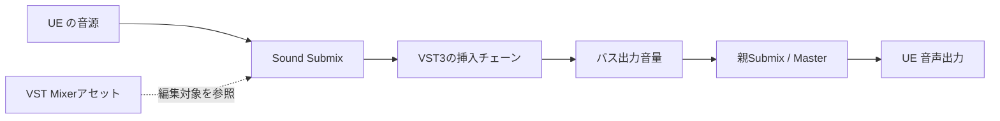

# Audio Plugin Host

Unreal Engine の音声に VST® 3 エフェクトをかけるプラグインです。VST Mixer アセットからバス、エフェクトの挿入順、GUI、バイパス、出力音量を編集します。

**UE 5.8 / Windows x64、ステレオ・32-bit float の VST3 Audio Effect** が対象です。バージョンは 0.1.0 beta。別の UE プロジェクトへ導入し、自分の音源と対応する VST3 を使えます。

→ **[プロジェクトへの導入と使い方](Docs/Guide.md)**

## どのように動くか

UE の Sound Submix に VST3 を挿入します。音源を対象の Submix へ送ると、そのバスのエフェクトを順に通って UE から出力されます。



VST Mixer は、編集するルートバスと追加バスの参照を保存します。音声経路と挿入順は Sound Submix、VST3 の設定は段ごとのプリセットが持ちます。ミキサーを作るだけでは音声経路は変わらず、音源の送信先を割り当てて使います。

インポートした VST3 はプロジェクト内へコピーし、Module Asset でパスとハッシュを管理します。プリセットはこの Module Asset を参照するため、複数段で同じ VST3 を使いながら、設定は別々に保存できます。

## 実装構成

プラグイン本体は `Plugins/AudioPluginHost` にあり、次の3モジュールに分かれます。

| モジュール | 担当 |
| --- | --- |
| AudioPluginHostRuntime | アセット型、Submix Effect、音声セッション |
| AudioPluginHostVST3 | VST3 SDK を使うロード、形式確認、DSP、パラメーター転送、ネイティブ GUI |
| AudioPluginHostEditor | VST3 インポート、VST Mixer の画面、編集・保存、PIE 開始前の状態取得 |

ロードと GUI 操作はゲームスレッド、DSP は音声コールバックで処理します。停止中の GUI は編集専用インスタンスを使い、PIE 中は音声を処理しているインスタンスへ接続します。

```text
Plugins/AudioPluginHost/   他のプロジェクトへ組み込むプラグイン
Docs/Guide.md              導入と使い方
```

開発・デモ用 UE プロジェクトは含めません。導入先のプロジェクトで、自分の音源・ミキサー・VST3 を用意して使います。

## 対応範囲

VST3 側の Main Input / Main Output が各1本のステレオエフェクトを扱います。バス構成と挿入構成の変更は停止中に行い、PIE 中は GUI、バイパス、出力音量を操作できます。保存と独立複製の手順は導入ガイドに記載しています。

VST Instrument、MIDI、VST2、VST3 側のサイドチェーン・追加 Audio Bus、経路間の遅延補正は対象外です。VST3 は UE と同じプロセスで動くため、信頼できるプラグインを使用してください。すべての VST3 製品との互換性を保証するものではありません。

## ライセンス

自作コードと文書は [MIT](LICENSE) です。VST3 SDK も MIT で、[SDK のライセンス原文](Plugins/AudioPluginHost/ThirdParty/vst3sdk/LICENSE.txt)と各サブディレクトリのライセンスを保持しています。

UE には [Unreal Engine EULA](https://www.unrealengine.com/eula/unreal)、持ち込む VST3 には各製品のライセンスが適用されます。インポートによって再配布の許諾が得られるわけではありません。

VST is a registered trademark of Steinberg Media Technologies GmbH.
